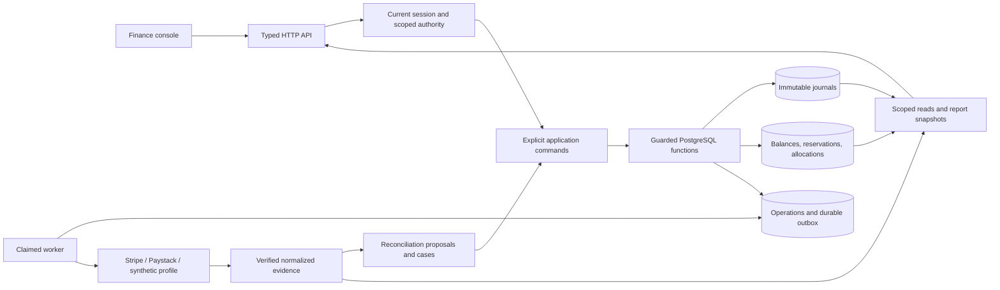

# Architecture

## Selected shape

Journalwick is a transactional modular monolith. The API, worker, migrations, and finance console have separate responsibilities and identities, while the initial financial acceptance boundary stays in one PostgreSQL database. This keeps journal, reservation, account projection, and operation receipt changes atomic without putting provider HTTP requests or file parsing under financial locks.



## Authority and transaction rules

1. The browser submits exact canonical strings and reviewed identifiers; it never decides a balance or posts a journal locally.
2. The HTTP layer authenticates the actual session, validates DTOs, and checks current resource scope. Collection filtering or a hidden button is not authorization.
3. The application coordinator recovers a previously accepted idempotent result before evaluating new-write eligibility, when current result-read authority permits.
4. Database functions validate current stored command facts, expand the accepted typed template, serialize writes for the book, enforce funds/period/approval invariants, and accept journal lines atomically.
5. Ordinary runtime roles cannot directly mutate protected financial tables or execute private helper functions.
6. Provider intent is durably stored before network dispatch. The worker commits its claim/fence, performs network I/O outside financial locks, then records verified evidence or an explicit unknown result.
7. Reports use selected journal/state/evidence boundaries and label incomplete or subset coverage. No reader mutates accepted financial history.

## Financial facts

- Amounts are bounded integer minor units represented on HTTP/browser wires as canonical decimal strings.
- Currency exponent and other accounting meaning are immutable versions; JPY and exponent-3 fixtures are valid without assuming two decimal places.
- `journal_sequence`, `state_sequence`, and `evidence_epoch` identify distinct observation boundaries; none is a pre-commit or global approximation.
- Accepted journals are append-only. Corrections create new, linked records and cannot retroactively reopen a period or reactivate an old reservation.
- A hold changes available funds without pretending to be a posted debit. Unknown external provider exposure is not expired merely because time passed or a lookup returned no object.
- A mixed-currency journal is balanced independently per currency. The console never combines unrelated units into a single total.

## Module and import direction

```text
HTTP routes → application command coordinators → domain + typed repositories → PostgreSQL
Provider adapters → normalized source evidence → approved command proposal → PostgreSQL kernel
Reporting read models ← accepted journal / reservation / evidence records
Console → generated/validated API contract → HTTP routes
```

Domain modules do not import FastAPI. Provider code does not import a repository that can insert postings. Reporting does not call mutation helpers. Shared platform code stays small; no generic SQL API accepts caller-provided table or column names.

## Database roles

The baseline separates a non-login kernel owner, a controlled migrator, runtime API, worker, reporter, and protected recovery identity. Development trust is an explicitly local synthetic fixture only. Release uses managed PostgreSQL with TLS, IAM database authentication, separate host roles, external key/secret custody, and reviewed migration execution.

## Honest operating limits

Initial book-level serialization favors inspectable financial correctness over unmeasured parallel throughput. Separate API and worker deployment roles do not by themselves create whole-application high availability. Local synthetic provider behavior proves only fixture behavior. A database restore alone cannot prove provider state or reestablish current authority.

## Source mapping

The authoritative details are in chapters `20`, `30–45`, `60–67`, and `80–84` of the Day 03 blueprint. The local structure is intentionally adjusted only for the user-selected workspace path.
